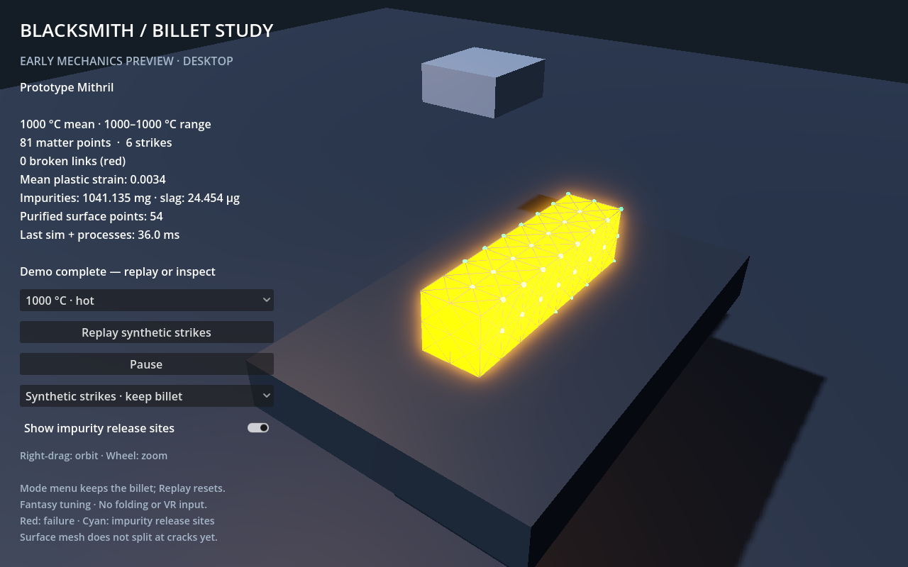
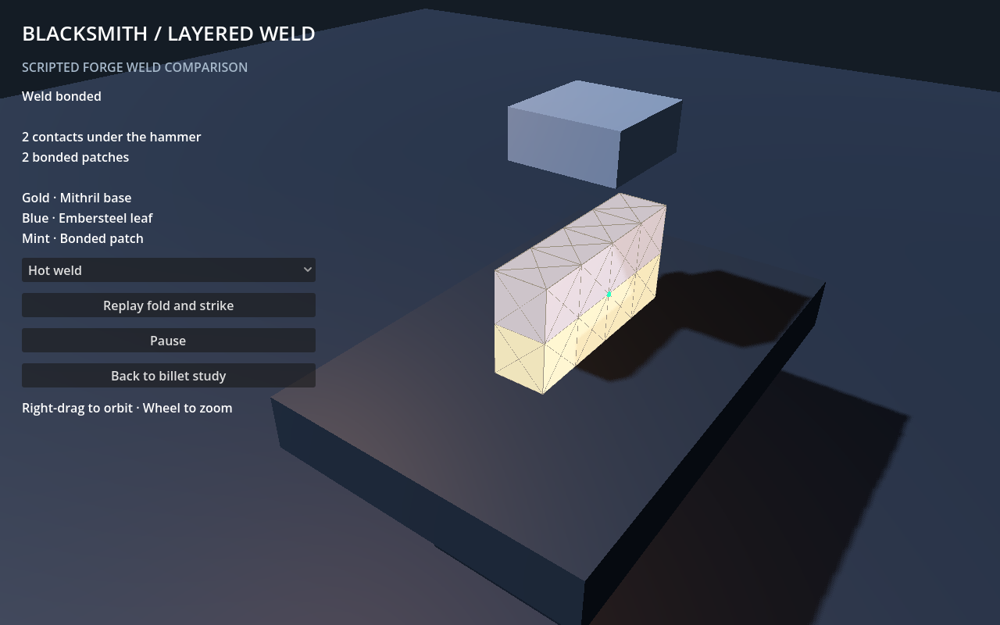
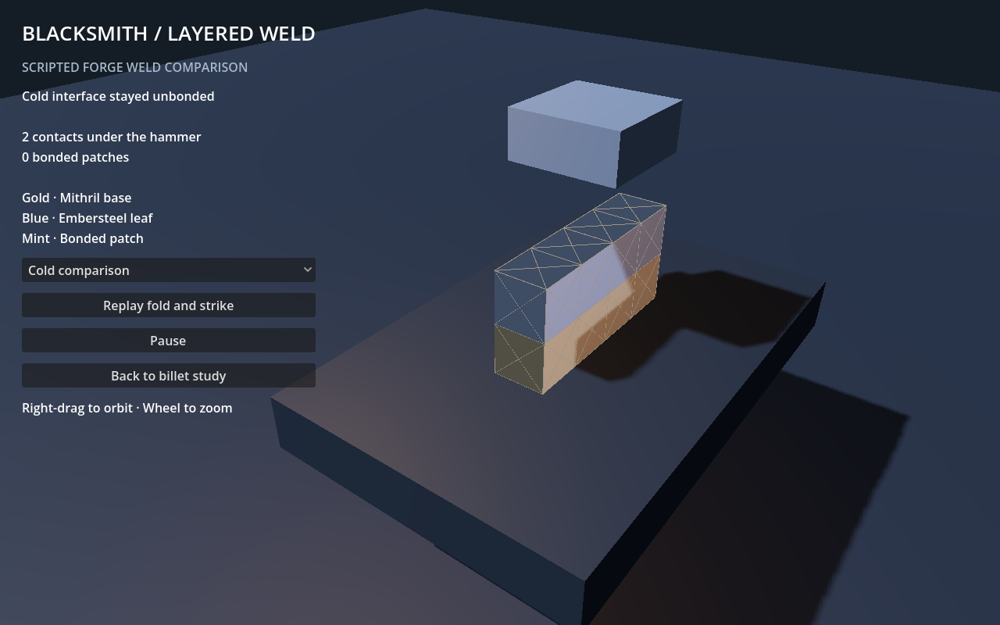

# Blacksmith VR

A VR blacksmithing simulator with granular, data-driven materials and physical forging.

## Open a project

Run `python3 tools/prepare_preview.py` from the repository root to refresh
both launch folders. Open one of these files in **Godot 4.7+ Standard** and
press **F5**.

| Project | Use |
| --- | --- |
| `Desktop/project.godot` | Billet study, material selection and scripted desktop scenes |
| `VR/project.godot` | Interactive forge room, tracked hands and tools through SteamVR |

The launch folders are siblings at the repository root. The shared source,
project template and build caches are maintained from the repository root.
Refresh the same folders after source changes. To inspect the forge room
without a headset, open `scenes/forge_room_study.tscn` from Desktop and press **F6**.

- Right mouse drag: orbit. Mouse wheel: zoom.
- Use the temperature dropdown to restart hot (1000 °C) or cold (20 °C).
- Replay resets the billet and restarts the synthetic sequence; Pause/Resume
  allows inspection.
- Choose an environment in **Thermal inspection** to stop synthetic strikes and
  heat, air-cool, or quench the billet. Switch environments repeatedly; Pause
  freezes it. Select **Synthetic strikes · keep billet** to work the same billet
  again after heating or a completed sequence. Strike mode holds its current
  temperatures constant for comparison; Replay resets the fixture.
- The panel reports local temperature range, plastic strain, broken links and
  the most recent CPU step.
  Red lattice links are broken; the surface mesh does not split at cracks yet.
- The panel tracks remaining impurity mass and expelled slag. Cyan markers show
  surface points that released impurities; the toggle hides/shows those sites.

The strike demo keeps its selected temperature constant. Thermal inspection uses
local conduction, Newton cooling, radiation and material quench curves. The
prototype forge requests 1600 °C but is capped at 1400 °C by fixture equipment
data; these are provisional demo settings, not final equipment balance.
Forging purification now requires exposed, permanently spreading matter in the
authored temperature window. It removes a fraction of remaining impurity mass,
subtracts it locally and records discarded slag. Interior/elastic matter and
heat alone do not purify. These are the accepted game rules, not claims of real
metallurgical refining behavior. Folding/welding, tracked hammering, naming and
inventory are not wired into this preview. Materials and mechanics are provisional; this is useful visual
feedback for development, not calibrated forging behavior. Both hot and cold
billets now remain intact under their own weight before strikes. The hammer block
illustrates scripted impacts; it is not a tracked or simulated rigid-body tool.

The fixture preserves the solver's 4 substeps × 8 iterations and 1/90 s numerical
step. It runs at most one step per rendered frame: slow rendering slows demo time
without increasing the timestep or building a catch-up queue. Lower development
frame rates are accepted. The 5,000-point benchmark and production 90 Hz / <1 ms
simulation targets remain separate; optimization is deferred behind visual work.

For automated scene verification or an actual rendered capture:

```sh
godot --headless --path Desktop -- --preview-smoke --preview-purification
godot --headless --path Desktop -- --preview-smoke --preview-cold
godot --headless --path Desktop -- --preview-smoke --preview-heat
godot --headless --path Desktop -- --preview-smoke --preview-quench
godot --path Desktop -- --preview-heat --preview-capture=/absolute/path/preview.png
```

Add `--preview-before-strike` to verify/capture the undamaged resting billet.
Heat/quench captures run six simulated seconds without strikes.
The normal strike runs finish after six synthetic strikes and check for finite
geometry and a mechanical response. Captures require a working graphical display and driver.
The preview has been rendered on Windows / RTX 3080 Ti / Vulkan Forward+ and run
headlessly on Linux/WSL. No XR headset or tracked input is validated yet.

Work is tracked in [GitHub issues](https://github.com/DayTF/blacksmith-vr/issues).
The scripted M0 processes and forging replay are implemented. The production
performance gate and tracked input (#15) remain open.

Thermal inspection currently uses reference grid surface areas and assumes the
whole boundary sees the selected environment. It does not model anvil heat
exchange, evolving fracture/fold surfaces, latent heat, thermal expansion or
quench stress. These limits are separate from the local temperature/phase and
work-hardening recovery now implemented.


Current geometric surface queries account for buried/contacting layers, even
before welding. The headless simulation supports scripted stacking, folding, and
hammer-driven welds (#12). Open the layered weld replay from the desktop study to inspect the fold. Failed/inverted cells are conservatively ineligible for
purification, not treated as holes. Fully exhausting an all-impurity granule is
rejected atomically; zero-mass topology deletion is not implemented.



## Headless forging replay

```sh
validation_dir="$(mktemp -d)"
python3 tools/prepare_preview.py --validation-dir "$validation_dir"
godot --headless --path "$validation_dir" --editor --import --quit
godot --headless --path "$validation_dir" --script tests/forging_harness.gd
godot --headless --path "$validation_dir" --script tests/benchmark_mechanics.gd -- --backend=native-resident
```

The replay emits JSON checkpoints for a mixed-material billet through heating,
folding, welding, spreading with surface purification, and quenching. Each
checkpoint records local positions, temperatures and impurity masses.
The separate 5,000-node mechanics benchmark measured 15.102 ms per warmed
step against the 1 ms budget. [Benchmark samples](benchmarks/forging-harness-mechanics.json)


## Try the layered weld replay

Run `python3 tools/prepare_preview.py`, open `Desktop/project.godot`
in Godot 4.7 Standard, and press **F5**. Select **Open layered weld replay**.
Watch the hot pass, then choose **Cold comparison**. The same two patches
contact under the hammer. The hot strike creates two mint-marked bonds and the
cold strike leaves both contacts unbonded. Right-drag to orbit and scroll to zoom.

The replay uses 40 simulation points with two fantasy materials. Color tints
identify the layers and the scripted hammer lets both cases use the same
strike. The replay ends at the welding strike.




## Try tracked hammering in SteamVR

1. Run `python3 tools/prepare_preview.py` to refresh the launch folders.
2. Start SteamVR with your headset connected and select SteamVR as the active
   OpenXR runtime in SteamVR settings.
3. Open `VR/project.godot` in Godot 4.7 Standard and press **F5**.
4. Face the anvil, pick up a hammer, and swing at the billet. The mirror
   window shows the hit count, simulation step time, and host FPS.

The VR project uses a 30-point reference fixture when native libraries are unavailable.
The initial grip offset is in `data/preview/tracked_hammer.json`. The fixture
uses an OpenXR hand joint when available and falls back to the right controller's
grip pose. The fixture uses the runtime controller model when available and a simple grip
proxy otherwise.
Headset tracking, grip alignment and headset frame timing need a hardware pass.

The larger XR fixture uses the native solver. With the extension built for
your host, run `python3 tools/prepare_preview.py --xr --native` and open
`VR/project.godot`. This fixture is 37.5 × 25 × 75 mm
with 12.5 mm simulation spacing. Use `--xr` by itself to stage the smaller
reference fixture in the same VR folder.

## Forge room study

Open `scenes/forge_room_study.tscn` and press **F6** for the fixed desktop
view. The room shell contains the forge, anvil, side quench tank and wall
rack. Equipment and tracked interactions are developed separately.
[Desktop capture](docs/previews/forge-room-study.png)

The checked-in GLB can be rebuilt with
`blender --background --python assets/forge_room/build_room.py`.

### Interactive XR room controls

- Walk physically in your tracked area. Push either thumbstick forward or hold
  its click, aim at clear floor, and release when the green marker appears.
- Point your index finger and hold the trigger to bring the targeted object
  into the aiming hand. Squeeze either grip for a nearby object. Optical hand
  tracking uses a thumb/index pinch. Release to drop or place the object.
- Pick up the live billet on the anvil and carry it through the forge opening
  to heat it. The glowing blanks already in the hearth are loose stock props.

Let Godot import the room assets when opening a freshly staged VR project.
Steam Frame controller bindings and comfort still need a hardware pass.
