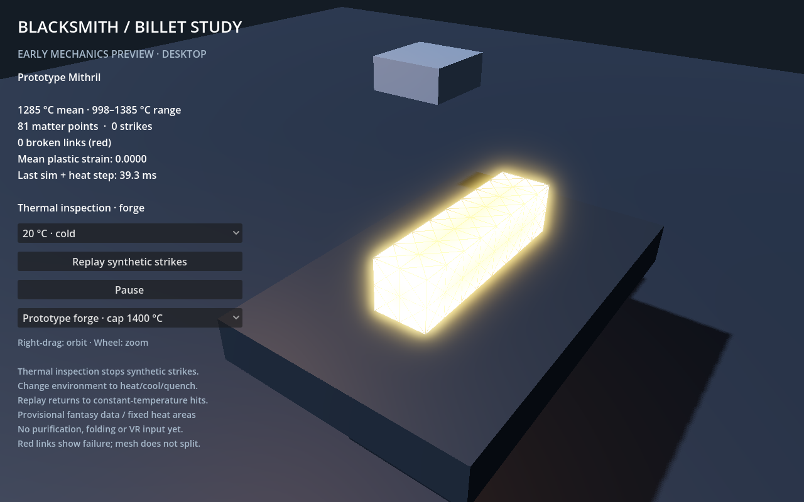

# Blacksmith VR

A VR blacksmithing simulator with granular, data-driven materials and physical forging.

Try the early desktop preview now. It shows a small live billet under synthetic
hammer strikes: compare hot plastic deformation with cold fracture, replay/pause,
and orbit the view. Thermal inspection adds live heating, air cooling, and
water/oil quenching. This is an inspection demo, before tracked VR input or the
full forging loop.

```sh
python3 tools/prepare_preview.py
```

Open `.build/preview/project.godot` in **Godot 4.7+ Standard** and press **F5**.
This stages a GDScript-only, 81-point fixture: no C++ toolchain is needed for the
preview. Re-run the command after source changes. Alternatively, run
`godot --path .build/preview`. The full root project still requires the native
extension build described in [AGENTS.md](AGENTS.md).

- Right mouse drag: orbit. Mouse wheel: zoom.
- Use the temperature dropdown to restart hot (1000 °C) or cold (20 °C).
- Replay restarts the synthetic sequence; Pause/Resume allows inspection.
- Choose an environment in **Thermal inspection** to stop synthetic strikes and
  heat, air-cool, or quench the billet. Switch environments repeatedly; Pause
  freezes it. Replay returns to the constant-temperature strike demo.
- The panel reports local temperature range, plastic strain, broken links and
  the most recent CPU step.
  Red lattice links are broken; the surface mesh does not split at cracks yet.

The strike demo keeps its selected temperature constant. Thermal inspection uses
local conduction, Newton cooling, radiation and material quench curves. The
prototype forge requests 1600 °C but is capped at 1400 °C by fixture equipment
data; these are provisional demo settings, not final equipment balance.
Impurities, folding/welding, tracked hammering, naming and inventory are not wired
into this preview. Materials and mechanics are provisional; this is useful visual
feedback for development, not calibrated forging behavior. Both hot and cold
billets now remain intact under their own weight before strikes. The hammer block
illustrates scripted impacts; it is not a tracked or simulated rigid-body tool.

The fixture preserves the solver's 4 substeps × 8 iterations and 1/90 s numerical
step. It runs at most one step per rendered frame: slow rendering slows demo time
without increasing the timestep or building a catch-up queue. Lower development
frame rates are accepted. The 5,000-point benchmark and production 90 Hz / <1 ms
simulation targets remain separate; optimization is deferred behind visual work.

For automated scene verification or an actual rendered capture:

```sh
godot --headless --path .build/preview -- --preview-smoke
godot --headless --path .build/preview -- --preview-smoke --preview-cold
godot --headless --path .build/preview -- --preview-smoke --preview-heat
godot --headless --path .build/preview -- --preview-smoke --preview-quench
godot --path .build/preview -- --preview-heat --preview-capture=/absolute/path/preview.png
```

Add `--preview-before-strike` to verify/capture the undamaged resting billet.
Heat/quench captures run six simulated seconds without strikes.
The normal strike runs finish after six synthetic strikes and check for finite
geometry and a mechanical response. Captures require a working graphical display and driver.
The preview has been rendered on Windows / RTX 3080 Ti / Vulkan Forward+ and run
headlessly on Linux/WSL. No XR headset or tracked input is validated yet.

Work is tracked in [GitHub issues](https://github.com/DayTF/blacksmith-vr/issues).
The next priorities are local surface purification (#11), broader manipulation
and XR integration (#15). Optimization (#33) remains deferred.

Thermal inspection currently uses reference grid surface areas and assumes the
whole boundary sees the selected environment. It does not model anvil heat
exchange, evolving fracture/fold surfaces, latent heat, thermal expansion or
quench stress. These limits are separate from the local temperature/phase and
work-hardening recovery now implemented.


